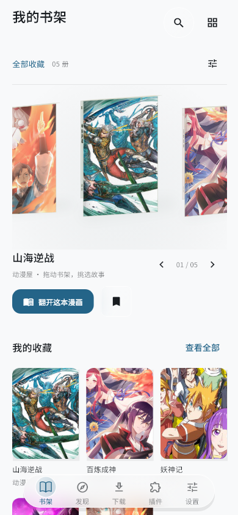
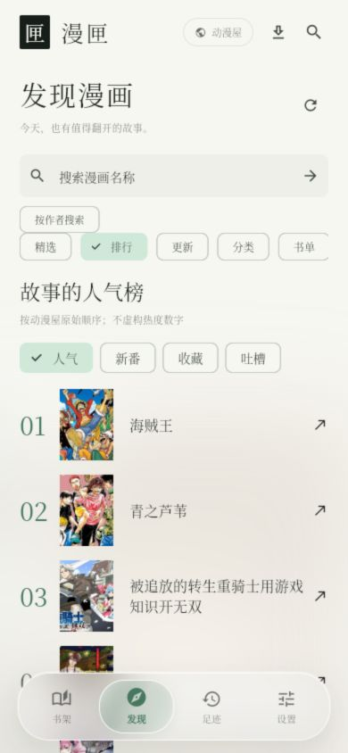
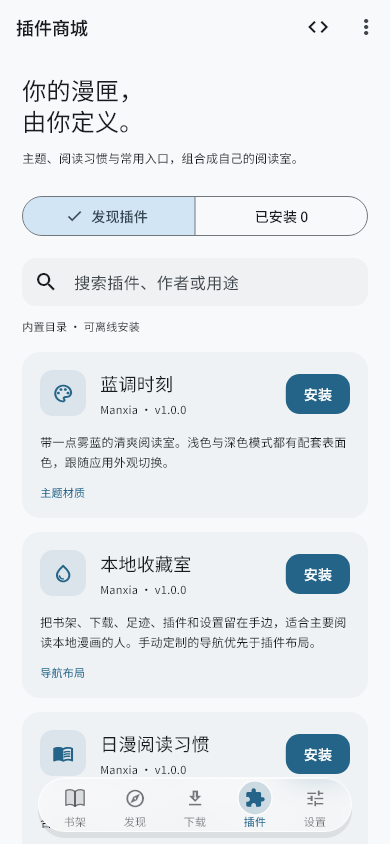
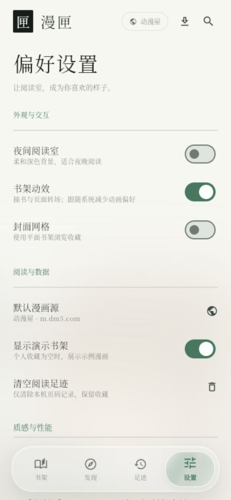

<p align="center">
  
</p>

<h1 align="center">漫匣 · Manxia</h1>


<p align="center">把喜欢的故事，留在手边。</p>
<p align="center">一个注重书籍质感与阅读体验的 Flutter 漫画阅读器</p>

<p align="center">
  <a href="https://github.com/LexianLix/manxia/releases/latest"></a>
  <a href="https://github.com/LexianLix/manxia/actions/workflows/ci.yml"></a>
  
  <a href="LICENSE"></a>
</p>

<p align="center">
  <a href="https://github.com/LexianLix/manxia/releases/latest">下载安装</a> ·
  <a href="CHANGELOG.md">更新日志</a> ·
  <a href="docs/USER_GUIDE.md">使用指南</a> ·
  <a href="docs/PLUGINS.md">插件开发</a> ·
  <a href="https://github.com/LexianLix/manxia/issues">问题反馈</a> ·
  <a href="docs/RELEASE.md">构建与发布</a>
</p>

## 简介

漫匣面向 Android 手机与平板，将漫画发现、个人书架、本地导入与离线阅读放在一起。以清透的晴昼玻璃为默认外观，浅弧环绕书架、实体书装订与紧凑的悬浮导航，让收藏与阅读保留实体书的手感。可使用自己的背景图片，并让导航、按钮和阅读工具栏跟随图片配色。

默认接入动漫屋，支持每日精选、完整栏目浏览、分类搜索和原站榜单；也可以导入自己的图片、CBZ 或 PDF，整理成随身书库。收藏、进度和离线内容保存在本机，可手动备份或配置 WebDAV。

## 界面预览

<p align="center">
  
</p>
<p align="center"><sub>沿书脊向外翻开封面与书页 · 手机尺寸 Flutter 帧回放（测试收藏与封面缓存，版权状态按原站响应显示）</sub></p>

<p align="center">
  
  &nbsp;
  
  &nbsp;
  
  &nbsp;
  
</p>

<p align="center"><sub>立体书架 · 漫画发现 · 插件阅读室 · 分级设置。书架展示测试收藏，发现页展示缓存目录；实际内容以所选漫画源为准。Android 系统栏与渲染细节可能有所不同。</sub></p>

## 功能特性

- **立体书架**：漫画封面满幅装订，书脊随封面取色；封面和书页沿书脊展开，返回时合书归位。沿浅弧循环环绕，快速甩动后惯性滑行、减速吸附，支持疏密调整与列表展示。
- **玻璃界面**：紧凑居中底栏、水滴连接与吸附回弹、选中图标短动画；页面短暂渐显并小幅移动，封面加载渐显，快速切换承接当前画面。支持减少动效与材质质量调整，可在外观设置中进行本机流畅度检测。
- **背景与配色**：从本机选择图片，自动提取主题色，也可保留默认蓝色；支持遮罩、柔化和恢复默认背景。图片只保存在本机，缺失时显示主题底色。阅读界面的工具栏、目录和设置沿用同一套设计。
- **插件阅读室**：插件商城支持安装、启停、更新、配置和卸载；可组合主题、阅读预设、漫画源与导航布局，支持本地插件文件和自定义在线仓库。
- **清晰的设置**：外观、阅读、漫画源、下载缓存、备份同步与更新各自独立；语言与可读性进一步分层，保留大字号选择。
- **个性化入口**：默认书架、发现、下载、插件和设置五个入口；可添加足迹、调整顺序与启动页面。阅读可设置亮屏、双页默认值、背景及工具栏自动收起。
- **漫画发现**：每日精选、人气／新番／收藏／吐槽榜单，分类、连载状态、排序与翻页；书名搜索优先匹配名称，收藏追更可查看未读与检查失败作品，并批量标为已读。
- **沉浸阅读**：连续条漫、横向或竖向分页、左右阅读方向与宽屏双页；支持曲面翻页、缩放、裁白边、自动滚动、图片内位置续读和逐本偏好。
- **阅读工具**：进度拖动预览、章节搜索与当前章节定位、多书签、笔记、页面收藏、图片预载，以及亮度、暖色和背景调整；接近章末预备下一章首屏，章末可标为已读并继续，切章后可返回原位置。左右手预设、点击分区与底部集中工具栏可按漫画调整。
- **书库整理**：自定义分组、标签、阅读状态、排序、拖动与批量操作；阅读足迹可按日期查看和搜索；章节已读标记与整本进度、继续阅读置顶、手动归档及可选的读完自动归档。
- **离线与导入**：章节下载队列、优先下载、批量暂停与失败重试、并发控制、缓存统计与 CBZ 导出；离线空间按书与章节整理，支持下载容量上限、已读筛选和确认后批量清理；支持图片、原生端文件夹、ZIP／CBZ 和 PDF 导入。
- **备份与同步**：JSON 资料备份、包含离线图片及 SHA-256 清单的 ZIP 书库备份；WebDAV 支持元数据合并与完整书库传输。
- **来源与偏好**：可配置静态 HTML 漫画源、检查来源状态；目录不可用时可在其他已配置书源中查找，保留原收藏和阅读位置。提供大字号及主要界面的简体、繁体和英文切换。

书架只展示自己的收藏；首次打开可从发现页加入喜欢的漫画。榜单沿用原站顺序；每日精选与个人推荐从目录选取，不生成虚构热度。

可在漫画源设置或搜索页隐藏已确认不可读的在线作品。版权与失效状态按来源在本机保留 24 小时；连接失败不会标为没有版权，个人收藏与已下载文件始终保留。

## 插件与创作

内置暖纸书房、蓝调时刻、日漫阅读习惯、条漫长卷和本地收藏室等插件。也可以制作自己的插件，通过 JSON 清单定义主题、阅读参数、静态 HTML 漫画源和导航布局，无需重新编译应用。

插件 API 1、清单结构、完整模板及仓库格式见 [插件开发指南](docs/PLUGINS.md)，示例位于 [`plugins/`](plugins/)。开发工具提供清单校验和目录生成；在线插件安装核对 SHA-256，个人书库与逐本设置独立保留。

## 下载与更新

当前发行版：**[v0.4.3](https://github.com/LexianLix/manxia/releases/tag/v0.4.3)**，支持 **Android 7.0+**。提供使用固定项目密钥签名的 **Release 模式 APK**，按设备架构分包。

| 设备 | 安装包 |
| --- | --- |
| 常见 Android 手机、平板（推荐） | [ARM64 · arm64-v8a](https://github.com/LexianLix/manxia/releases/download/v0.4.3/Manxia-0.4.3-arm64-v8a.apk) |
| 旧款 32 位 ARM 设备 | [ARMv7 · armeabi-v7a](https://github.com/LexianLix/manxia/releases/download/v0.4.3/Manxia-0.4.3-armeabi-v7a.apk) |
| x86_64 设备或模拟器 | [x86_64](https://github.com/LexianLix/manxia/releases/download/v0.4.3/Manxia-0.4.3-x86_64.apk) |
| 下载完整性校验 | [SHA256SUMS.txt](https://github.com/LexianLix/manxia/releases/download/v0.4.3/SHA256SUMS.txt) |

下载对应 APK 后安装即可。同签名、同架构的新版 APK 可以直接覆盖安装，无需卸载。安装 v0.4.0 后，可从“设置 → 关于与更新 → 检查 GitHub 更新”下载后续版本；应用匹配设备架构并校验安装包，随后交给 Android 系统确认安装。首次使用可能需要允许漫匣安装应用。浏览器版提供发行页入口。历史版本、源码归档和发行说明见 [GitHub Releases](https://github.com/LexianLix/manxia/releases)。

**从旧测试包迁移**：旧 Debug／Profile 包使用临时证书，无法保证覆盖安装。请先在旧版导出完整离线书库 ZIP 和资料 JSON，保存到应用外，再卸载旧包、安装发行版并导入备份。WebDAV 密码需重新填写。详见 [升级与恢复](docs/RELEASE.md#升级与恢复)。

## 使用说明

| 想做什么 | 从这里开始 |
| --- | --- |
| 找漫画、收藏、阅读与导入 | [使用指南](docs/USER_GUIDE.md) |
| 备份、换机与安装包签名 | [发布与迁移](docs/RELEASE.md) |
| 配置默认源或自定义来源 | [漫画来源](docs/SOURCES.md) |
| 调整玻璃、动画和性能 | [界面动效](docs/MOTION.md) · [性能说明](docs/PERFORMANCE.md) |
| 开发与参与贡献 | [贡献指南](CONTRIBUTING.md) · [插件接口](docs/PLUGINS.md) |

在线内容的可用性取决于来源站点与网络；浏览器清理站点数据会移除本地书库，请定期导出备份。

## 从源码构建

开发环境：**Flutter 3.47.7 / Dart 3.13.5**；Android 构建另需 **JDK 17 与 Android SDK**。Web 预览使用 **Node.js 22+**。

```sh
git clone https://github.com/LexianLix/manxia.git
cd manxia
flutter pub get
```

### Android

先完成 `flutter doctor` 中的 Android 环境配置。Windows 下生成自己的私有签名配置，再构建：

```powershell
.\tools\Create-Signing.ps1
.\tools\Build-Android.ps1 -Release
```

其他平台按 [发布指南](docs/RELEASE.md) 配置 `android/key.properties` 后运行：

```sh
flutter build apk --release --split-per-abi
```

自行构建的签名与官方发行包不同，不能直接作为官方包的覆盖更新。密钥与密码不要提交到仓库。

### Web 本地预览

```sh
npm ci --ignore-scripts
node tools/prepare-web.mjs
node tools/plugin-sdk.mjs build
flutter build web --wasm --no-web-resources-cdn
node tools/offline-shell.mjs
node tools/preview.mjs
```

打开 <http://127.0.0.1:4173>。Windows 也可运行 `.\启动预览.ps1 -Rebuild`，后续运行 `.\启动预览.ps1` 复用已有构建。

预览服务仅监听本机，并提供在线来源所需的 `/api` 网关。首次加载后支持离线打开应用及已缓存内容；单独部署静态文件或使用 `flutter run -d chrome` 不包含该网关。Android 直接访问来源站点。

Web 构建包含 WebAssembly 与 JavaScript 回退版本。预览服务已配置渲染工作线程需要的隔离响应头；自行部署时需保留 `Cross-Origin-Opener-Policy: same-origin` 和 `Cross-Origin-Embedder-Policy: credentialless`，并为 `.wasm` 文件提供 `application/wasm` 类型。

### 检查与自动构建

```sh
flutter analyze --no-pub
flutter test --timeout 30s
node --test tools/preview.test.mjs tools/plugin-sdk.test.mjs
```

- [Check and build](https://github.com/LexianLix/manxia/actions/workflows/ci.yml)：分析、测试、Web 构建与 Android Profile 测试包。
- [Prepare Android release](https://github.com/LexianLix/manxia/actions/workflows/release-build.yml)：手动触发校验与各架构 Release 构建，产出供维护者本地签名的未签名包；**可安装发行包以 Releases 为准**。

需要在线检查来源时运行 `dart run tool/probe.dart`，结果仅代表当时网络与样本的状态。

## 参与贡献

欢迎通过 [Issues](https://github.com/LexianLix/manxia/issues/new/choose) 反馈问题或提出建议，也欢迎提交 Pull Request 改进阅读体验、来源解析和无障碍支持。

反馈时请提供应用版本、设备与系统版本、复现步骤，以及去除个人信息的截图或日志。开发约定与检查方式见 [贡献指南](CONTRIBUTING.md)。

## 致谢与许可

视觉设计受到 [Wenku8_Flutter](https://github.com/mikufoxxx/Wenku8_Flutter) 的启发。漫匣的应用代码独立实现，未复制其应用代码。

- 应用源码：[MIT License](LICENSE)。
- 内置字体：[Adobe Source Han Serif](https://github.com/adobe-fonts/source-han-serif)，[SIL OFL 1.1](assets/fonts/OFL.txt)。
- Web PDF 渲染：[Mozilla PDF.js](https://github.com/mozilla/pdf.js)，Apache License 2.0。
- 界面与跨平台能力：[Flutter](https://flutter.dev)。

第三方声明见 [NOTICE](NOTICE)。远程漫画元数据、封面与正文的权利归相应权利人，不适用应用代码许可；仓库不包含漫画正文图片。
