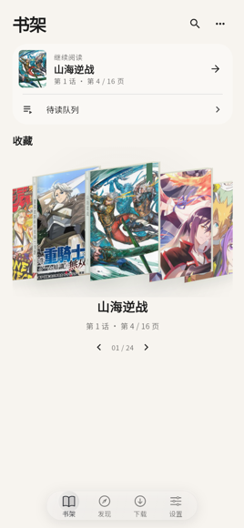
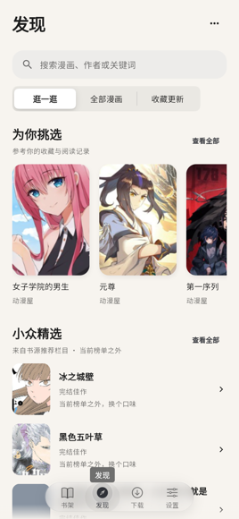

<p align="center">
  
</p>

<h1 align="center">漫匣 · Manxia</h1>

<p align="center">一款带立体书架的开源漫画阅读器。整理收藏、排好待读，随时接着读。</p>

<p align="center">
  <a href="https://github.com/LexianLix/manxia/releases/latest"></a>
  
  <a href="https://github.com/LexianLix/manxia/actions/workflows/ci.yml"></a>
  <a href="LICENSE"></a>
</p>

<p align="center">
  <a href="https://github.com/LexianLix/manxia/releases/latest"><strong>下载 Android 安装包</strong></a> ·
  <a href="docs/USER_GUIDE.md">使用指南</a> ·
  <a href="docs/PLUGINS.md">插件开发</a> ·
  <a href="CHANGELOG.md">更新日志</a>
</p>

<p align="center">
  
  &nbsp;
  
</p>

<p align="center"><sub>v0.5.9 的书架与发现页，截自手机尺寸的 Web 预览，使用测试收藏与缓存目录。</sub></p>

## 阅读与整理

- **书架和待读队列**。在立体书架与封面网格之间切换，用分组、标签和归档整理收藏。从发现或详情加入待读，按自己的顺序排书，当前目录读完后可从章节结束菜单打开下一本。
- **续读和找页**。回到上次的章节、页码或条漫位置。用缩略图、目录、书签和阅读位置记录找页，临时跳转后也能回到原处。Android 桌面「继续阅读」小组件可直接打开最近阅读的作品。
- **阅读方式**。支持横向或竖向分页、连续条漫和宽屏双页。可逐本调整阅读方向、点击区域、画面设置和工具栏布局，也可保存自己的阅读预设。
- **轻透书廊**。从立体书架打开作品时，封面连续过渡到详情。底部导航和阅读工具栏采用通透玻璃材质，底栏可随滚动收起。支持自定义背景、轻量材质和减少动效。
- **个人阅读记录**。查看阅读时长、浏览页数和常读作品，也可为每本漫画写评分与短评。

## 找漫画与离线阅读

- **发现和追更**。内置动漫屋、Mangabz 和咚漫漫画，支持跨源搜索、目录浏览和收藏更新。切换来源时可手动确认对应章节。来源能力与限制见[漫画来源说明](docs/SOURCES.md)。
- **下载和本地导入**。按章下载，支持暂停、重试和容量管理。可导入图片、ZIP、CBZ、PDF，或在原生端导入图片文件夹。本地漫画与已下载章节可以断网阅读。
- **备份和换机**。收藏、进度、评分与笔记保存在本机。可导出资料 JSON 或含离线图片的完整书库 ZIP，也可自选 WebDAV 同步。备份与恢复步骤见[使用指南](docs/USER_GUIDE.md#备份和恢复)。

## 安装与更新

适用于 **Android 7.0 及以上**。从 [GitHub Releases](https://github.com/LexianLix/manxia/releases/latest) 的 **Assets** 下载对应架构的 APK。

| 安装包后缀 | 适用设备 |
| --- | --- |
| `arm64-v8a.apk` | 多数 Android 手机和平板 |
| `armeabi-v7a.apk` | 旧款 32 位 ARM 设备 |
| `x86_64.apk` | x86_64 设备或模拟器 |

同一架构、同一项目签名的新版 APK 可以直接覆盖安装，保留书库。也可在 **设置 → 关于与更新 → 检查 GitHub 更新** 中获取正式版。校验文件、旧测试包迁移与备份步骤见[构建与发布指南](docs/RELEASE.md)。

## 插件

从 **设置 → 插件商城** 浏览和安装插件。主题、阅读预设、导航布局、静态漫画源及可选阅读伙伴可独立启用。支持导入本地插件和添加在线仓库。

API 1 使用 JSON 清单声明扩展，API 2 支持 Android JavaScript 漫画源。接口、权限、打包方法和仓库格式见[插件开发指南](docs/PLUGINS.md)，可从[示例目录](plugins/examples/)开始。

## 从源码构建

项目 CI 使用 **Flutter 3.47.7**。Android 构建需要 **JDK 17 和 Android SDK**，Web 预览需要 **Node.js 22+**。

```sh
git clone https://github.com/LexianLix/manxia.git
cd manxia
flutter pub get
```

Windows 下可运行以下命令构建自己的 Android 安装包。其他平台的签名和分架构构建步骤见[构建与发布指南](docs/RELEASE.md#自行构建)。

```powershell
.\tools\Create-Signing.ps1
.\tools\Build-Android.ps1 -Release
```

本地 Web 预览可在 Windows 运行 `.\启动预览.ps1 -Rebuild`。也可以手动构建，再启动提供漫画源网关的预览服务。

```sh
npm ci --ignore-scripts
node tools/prepare-web.mjs
node tools/plugin-sdk.mjs build
flutter build web --wasm --no-web-resources-cdn
node tools/offline-shell.mjs
node tools/preview.mjs
```

打开本机的 `http://127.0.0.1:4173`。提交前的检查与项目结构见[贡献指南](CONTRIBUTING.md)。欢迎在 [Issues](https://github.com/LexianLix/manxia/issues/new/choose) 反馈问题，附上应用版本、设备与系统、复现步骤。

## 版权、许可与致谢

漫匣源码采用 [MIT 许可](LICENSE)。第三方漫画的正文、封面和元数据归对应权利人，在线章节的可用性以原站为准。

视觉设计受到 Wenku8_Flutter 启发，玻璃材质和交互参考 Kototoro、AndroidLiquidGlass 与 Apple 的材质设计指南。[Wenku8_Flutter](https://github.com/mikufoxxx/Wenku8_Flutter) · [Kototoro](https://github.com/Kototoro-app/Kototoro) · [AndroidLiquidGlass](https://github.com/Kyant0/AndroidLiquidGlass) · [Apple 材质设计指南](https://developer.apple.com/design/human-interface-guidelines/materials)

项目使用 Flutter、Source Han Serif、由 Noto Sans SC 派生的界面字体，以及用于 Web PDF 渲染的 PDF.js。完整来源与许可见[第三方声明](NOTICE)。
